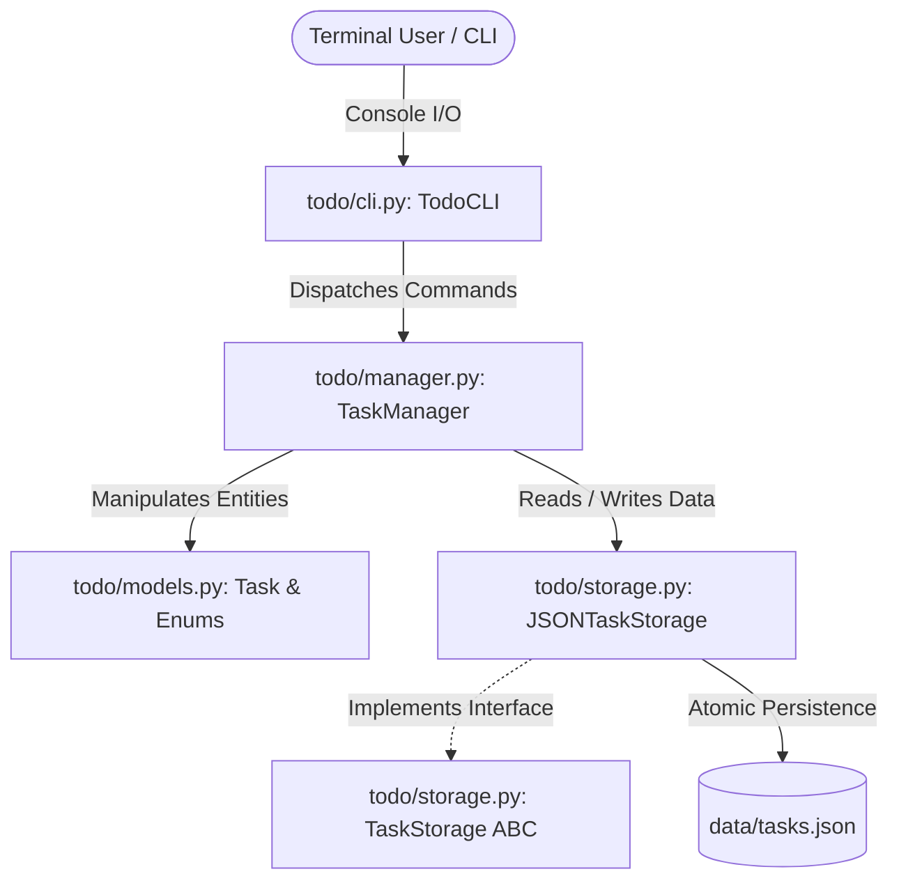

# Python Internship Certification Program

[](https://www.python.org/)
[](LICENSE)
[-brightgreen.svg)]()
[](https://github.com/Pratyaksh82/python-internship/actions)
[]()

Welcome to the **Python Internship Certification Program** repository. This repository houses all project milestones, architectural designs, modular source code, and comprehensive documentation developed during the Junior Python Developer Virtual Internship on the **Yuva Learn** certification platform.

- **Author:** Pratyaksh ([@Pratyaksh82](https://github.com/Pratyaksh82))
- **Primary Language:** Python 3.14+ (Standard Library, Zero External Dependencies)
- **Repository:** [python-internship](https://github.com/Pratyaksh82/python-internship)

---

## 📂 Certification Roadmap

| Milestone | Task Title | Core Technologies | Status |
| :--- | :--- | :--- | :---: |
| **Week 1** | **Python CLI Application Design and Implementation** | OOP, Dataclasses, Atomic JSON, Unit Testing | ✅ Completed |
| **Week 2** | **Debugging and Troubleshooting Python Applications** | pdb, Runtime Tracing, Root-Cause Analysis, Refactoring | ✅ Completed |
| **Week 3** | **Writing Automated Tests for Python Applications** | TDD, unittest, Integration Testing, Data Pipelines | ✅ Completed |
| **Week 4** | **Performance Optimization in Python Applications** | cProfile, timeit, lru_cache, Hash Sets, Benchmarks | ✅ Completed |
| **Week 5** | **Security Enhancements in Python Applications** | OWASP Top 10, PBKDF2-HMAC, Parameterized SQL, Sandboxing | ✅ Completed |
| **Week 6** | **Integrating Continuous Integration (CI) in Python Projects** | GitHub Actions, Multi-OS Matrix, flake8, bandit, coverage | ✅ Completed |

---

## 📝 Week 1: Python CLI Application Design & Implementation (To-Do List Manager)

### Overview
Week 1 delivers a modular, object-oriented **Command-Line Interface (CLI) To-Do List Manager**. Built entirely with Python's standard library, it emphasizes clean architecture, separation of concerns, defensive input validation, atomic data persistence, and automated test coverage.

### Key Features
- **Full CRUD Capabilities:** Add, list, inspect, edit, and delete tasks.
- **Priority Management:** Categorize tasks into `LOW`, `MEDIUM`, and `HIGH` priority levels with visual indicators.
- **Atomic JSON Storage:** Uses a write-to-temp-then-swap pattern (`os.replace`) to guarantee zero file corruption even upon unexpected system interruption.
- **Corrupted File Auto-Recovery:** Gracefully catches malformed JSON files, logs actionable warnings, and recovers without unhandled crashes.
- **Search & Multi-Field Filtering:** Search tasks by keyword across both titles and descriptions; filter by `PENDING` or `COMPLETED` status.
- **Productivity Analytics:** Displays total tasks, completed percentages, pending items, and priority distribution breakdowns.
- **Cross-Platform Console Compatibility:** Explicit UTF-8 stdout configuration with fallback replacement ensures error-free rendering on legacy Windows `cp1252` terminals.
- **100% Zero External Dependencies:** Runs natively on standard Python without requiring `pip install`.

---

## 🏛️ System Architecture

The application adopts a 4-tier layered architecture separating presentation, business logic, domain entities, and data persistence:



### Module Breakdown
- `main.py`: Application entrypoint; initializes dependencies, seeds initial demo tasks on fresh start, and runs the CLI loop.
- `todo/models.py`: Defines `Task` dataclass, `Priority` enum, `TaskStatus` enum, timestamp tracking, and JSON serialization.
- `todo/storage.py`: Declares `TaskStorage` abstract base class (ABC) and implements `JSONTaskStorage` with atomic file writes.
- `todo/manager.py`: Business logic orchestrator managing CRUD, sorting, filtering, keyword search, and productivity metrics.
- `todo/cli.py`: Terminal presentation layer featuring a 12-option menu, formatted ASCII table rendering, and defensive input guards.
- `tests/test_todo.py`: Automated test suite containing 17 unit tests verifying models, storage, and manager logic.
- `scripts/generate_week1_report.py`: Automated generator producing the formal 2,400+ word Word document report (`.docx`).

---

## 🚀 Quickstart & Usage

### Prerequisites
- Python 3.8 or newer (tested on Python 3.14).

### Running the Application
```bash
# Clone the repository
git clone https://github.com/Pratyaksh82/python-internship.git
cd python-internship

# Launch the interactive CLI
python main.py
```

### Interactive Menu Options
```text
-----------------------------------------------------------------------
 MAIN MENU
-----------------------------------------------------------------------
 1. ➕ Add New Task              7. ✏️  Update Task Details
 2. 📋 View All Tasks            8. 🗑️  Delete Task
 3. ⏳ View Pending Tasks        9. 🔍 Search Tasks by Keyword
 4. ✅ View Completed Tasks      10. 🧹 Clear All Completed Tasks
 5. ✔️  Mark Task as Completed    11. 📊 View Productivity Metrics
 6. 🔄 Mark Task as Pending      12. 🚪 Exit Application
-----------------------------------------------------------------------
```

---

## 🧪 Running Automated Unit Tests

The test suite validates model invariants, atomic file handling, corrupted file recovery, search algorithms, and CRUD operations:

```bash
python -m unittest discover -s tests -v
```

### Test Summary
```text
test_create_valid_task (test_todo.TestTaskModel) ... ok
test_empty_title_raises_value_error (test_todo.TestTaskModel) ... ok
test_mark_completed_and_pending (test_todo.TestTaskModel) ... ok
test_serialization_round_trip (test_todo.TestTaskModel) ... ok
test_corrupted_json_handled_gracefully (test_todo.TestJSONStorage) ... ok
test_load_non_existent_file_returns_empty_list (test_todo.TestJSONStorage) ... ok
test_save_and_load_tasks (test_todo.TestJSONStorage) ... ok
test_add_task_success (test_todo.TestTaskManager) ... ok
test_auto_incrementing_ids (test_todo.TestTaskManager) ... ok
test_clear_completed (test_todo.TestTaskManager) ... ok
test_filtering_tasks_by_status (test_todo.TestTaskManager) ... ok
test_get_task_success_and_not_found (test_todo.TestTaskManager) ... ok
test_remove_task (test_todo.TestTaskManager) ... ok
test_search_tasks (test_todo.TestTaskManager) ... ok
test_sorting_by_priority (test_todo.TestTaskManager) ... ok
test_statistics (test_todo.TestTaskManager) ... ok
test_update_task (test_todo.TestTaskManager) ... ok

----------------------------------------------------------------------
Ran 17 tests in 0.029s

OK
```

---

## 🔍 Week 2: Debugging and Troubleshooting Python Applications

### Overview
Week 2 centers on real-world troubleshooting, runtime tracing, and defensive code refactoring using Python's standard `pdb` module. An enterprise e-commerce order processor (`week2_debugging/`) was engineered to simulate 8 high-impact Python bugs across file I/O, sequences, dictionaries, scopes, and serialization.

### 8 Bugs Diagnosed & Resolved
1. **File I/O Resource Leaks:** Fixed raw `open()` calls by using `with` context managers and `os.path.exists` validation.
2. **Mutable Default Arguments:** Eliminated state leakage across function calls by replacing `items=[]` with `None` and defensive copy allocation.
3. **Off-by-One Loop Indexing:** Replaced 1-based indexing (`range(1, len+1)`) with direct Python iteration.
4. **Sequence Mutation in Iteration:** Eliminated skipped records by replacing in-place `remove()` with list comprehensions.
5. **Type Coercion & Zero-Division:** Added currency regex parsing and empty dataset length guards.
6. **Shallow Copy Mutations:** Replaced `list()` with `copy.deepcopy()` to isolate historical snapshots.
7. **Scoping & Variable Shadowing:** Standardized upfront variable initialization to eliminate `UnboundLocalError`.
8. **JSON Serialization Failures:** Implemented `DateTimeEncoder` inheriting `json.JSONEncoder` for ISO-8601 formatting.

### Running Week 2 Scripts
```bash
# Run automated bug diagnosis and verification script
python -m week2_debugging.debug_session

# Run corrected, refactored production engine
python -m week2_debugging.corrected_application
```

---

## 🧪 Week 3: Writing Automated Tests for Python Applications

### Overview
Week 3 focuses on **Test-Driven Development (TDD)** and automated test engineering using Python's standard `unittest` framework. A modular data processing, sanitization, and statistical aggregation engine (`week3_testing/engine.py`) was developed alongside an automated unit and integration test suite (`week3_testing/test_engine.py`).

### Key Modules Tested
- **`TextCleaner`:** String sanitization, whitespace collapsing, slugification, and PII email masking.
- **`MetricsCalculator`:** Arithmetic mean, median (odd/even), sample standard deviation, and IQR outlier boundaries.
- **`DataPipeline`:** Batch ingestion, schema validation, negative value prevention, and automated aggregation.

### Running Week 3 Tests
```bash
# Execute Week 3 automated unit & integration tests
python -m unittest week3_testing.test_engine -v
```

---

## ⚡ Week 4: Performance Optimization in Python Applications

### Overview
Week 4 focuses on **Performance Profiling, Algorithmic Optimization, and Benchmarking** using standard Python diagnostic tools (`cProfile`, `pstats`, and `time.perf_counter`). A high-volume financial transaction processing engine (`week4_optimization/`) was evaluated across 20,000 synthetic records, achieving a **389.70x speedup (99.74% latency reduction)**.

### Optimizations Applied
- **Set Membership vs. List Search:** Swapped linear list scans for $O(1)$ hash set lookups, eliminating 2,000,000 string comparisons.
- **Linear String Joining:** Replaced iterative `+=` string concatenation with list `.join()`, eradicating quadratic memory reallocations.
- **LRU Memoization:** Applied `@functools.lru_cache` to expensive mathematical fee calculations, cutting function calls from 16,000 to 5.
- **Single-Pass Aggregation:** Used `collections.defaultdict(float)` to eliminate dictionary membership branching.

### Running Week 4 Profiler
```bash
# Execute automated profiling and benchmark harness
python -m week4_optimization.benchmark_profiler
```

---

## 🔒 Week 5: Security Enhancements in Python Applications

### Overview
Week 5 focuses on **Application Security Hardening, Threat Modeling, and Vulnerability Remediation** aligning with the **OWASP Top 10** and **MITRE CWE** frameworks. A user authentication and sensitive data vault service (`week5_security/`) was audited, hardened, and verified against automated attack payloads.

### Vulnerabilities Remedied
- **SQL Injection (CWE-89):** Replaced raw string interpolation with parameterized SQLite queries (`?`), preventing authentication bypass (`admin' --`).
- **Insecure Password Hashing (CWE-256):** Upgraded obsolete MD5 to PBKDF2-HMAC-SHA256 (600,000 rounds + 32-byte cryptographically secure salt) and constant-time verification (`hmac.compare_digest`).
- **Insecure Deserialization (CWE-502):** Replaced vulnerable `pickle.loads` with safe JSON schema validation, neutralizing Remote Code Execution (RCE).
- **OS Command Injection (CWE-78):** Enforced regex hostname whitelisting (`^[a-zA-Z0-9.-]+$`) and disabled shell execution (`shell=False`).
- **Path Traversal (CWE-22):** Implemented canonical boundary checks via `os.path.commonpath`, preventing directory escape (`../../secret.txt`).
- **Information Disclosure (CWE-209):** Replaced verbose stack trace leaks with sanitized client error envelopes and internal audit logging.

### Running Week 5 Attack Simulations
```bash
# Execute automated attack simulation and verification suite
python -m week5_security.attack_simulation_test
```

---

## 🚀 Week 6: Integrating Continuous Integration (CI) in Python Projects

### Overview
Week 6 serves as the **Capstone DevOps Milestone**, establishing a fully automated Continuous Integration (CI) pipeline powered by **GitHub Actions** (`.github/workflows/ci.yml`). Every push and pull request targeting the `main` branch undergoes automated linting, security SAST scanning, multi-platform matrix execution (Ubuntu & Windows across Python 3.11 & 3.12), regression test suites, and test coverage calculation.

### Automated Quality Gates
- **PEP 8 Linting (`flake8`):** Restricts line length to 127 chars, enforces syntax validity, and prevents undefined variables.
- **Security SAST (`bandit`):** Audits Python AST for dangerous functions, shell injections, and deserialization hazards.
- **Regression Test Suites:** Automatically executes test suites across all 5 prior milestones.
- **Local Pre-Flight Runner:** Allows developers to execute `python scripts/run_local_ci.py` to replicate the entire CI suite locally in 3 seconds before pushing.

### Running Local CI Suite
```bash
# Execute local CI pipeline replicating all cloud gates
python scripts/run_local_ci.py
```

---

## 📄 Documentation & Deliverables

### Week 1 Deliverables
- **Formal Report (`.docx`):** [`docs/Python_CLI_TodoList_Week1_Report.docx`](docs/Python_CLI_TodoList_Week1_Report.docx) (2,444 words).
- **Source Code Archive (`.zip`):** [`docs/todo-cli-week1.zip`](docs/todo-cli-week1.zip).

### Week 2 Deliverables
- **Formal Report (`.docx`):** [`docs/Python_Debugging_Troubleshooting_Week2_Report.docx`](docs/Python_Debugging_Troubleshooting_Week2_Report.docx) (1,592 words).
- **Debugging Audit Log (`.md`):** [`week2_debugging/DEBUGGING_LOG.md`](week2_debugging/DEBUGGING_LOG.md).
- **Source Code & Log Archive (`.zip`):** [`docs/python-week2-debugging.zip`](docs/python-week2-debugging.zip).

### Week 3 Deliverables
- **Formal Report (`.docx`):** [`docs/Python_Automated_Testing_Week3_Report.docx`](docs/Python_Automated_Testing_Week3_Report.docx) (1,534 words).
- **TDD Test Documentation (`.md`):** [`week3_testing/TEST_DOCUMENTATION.md`](week3_testing/TEST_DOCUMENTATION.md).
- **Source Code & Test Archive (`.zip`):** [`docs/python-week3-testing.zip`](docs/python-week3-testing.zip).

### Week 4 Deliverables
- **Formal Report (`.docx`):** [`docs/Python_Performance_Optimization_Week4_Report.docx`](docs/Python_Performance_Optimization_Week4_Report.docx) (1,526 words).
- **Profiling Benchmark Report (`.md`):** [`week4_optimization/PROFILING_BENCHMARK_REPORT.md`](week4_optimization/PROFILING_BENCHMARK_REPORT.md).
- **Source Code & Profiler Archive (`.zip`):** [`docs/python-week4-optimization.zip`](docs/python-week4-optimization.zip).

### Week 5 Deliverables
- **Formal Report (`.docx`):** [`docs/Python_Security_Enhancements_Week5_Report.docx`](docs/Python_Security_Enhancements_Week5_Report.docx) (1,508 words).
- **Security Audit Report (`.md`):** [`week5_security/SECURITY_AUDIT_REPORT.md`](week5_security/SECURITY_AUDIT_REPORT.md).
- **Source Code & Attack Harness Archive (`.zip`):** [`docs/python-week5-security.zip`](docs/python-week5-security.zip).

### Week 6 Deliverables
- **Formal Report (`.docx`):** [`docs/Python_CI_Integration_Week6_Report.docx`](docs/Python_CI_Integration_Week6_Report.docx) (1,517 words).
- **CI Pipeline Documentation (`.md`):** [`docs/CI_PIPELINE_DOCUMENTATION.md`](docs/CI_PIPELINE_DOCUMENTATION.md).
- **GitHub Actions Configuration (`.yml`):** [`.github/workflows/ci.yml`](.github/workflows/ci.yml).
- **Source Code & CI Config Archive (`.zip`):** [`docs/python-week6-ci.zip`](docs/python-week6-ci.zip).

---

## 👤 Author
- **Pratyaksh** — [@Pratyaksh82](https://github.com/Pratyaksh82)
- Program: Junior Python Developer Virtual Internship (Yuva Learn)
